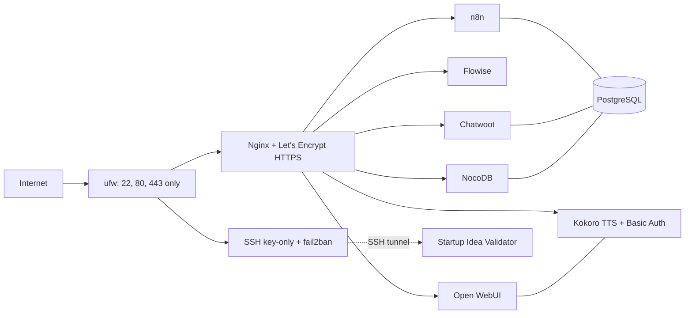

# VPS Automation Lab

A self-hosted AI automation server I set up, secure and maintain end to end: Docker services behind Nginx and HTTPS, closed firewall, key-only SSH, and AI apps running 24/7 on one Contabo VPS.

## Architecture

All containers listen only on `127.0.0.1`. The only way in from outside is Nginx over HTTPS or SSH with a key.

## Services

- n8n: [n8n.lilia.am](https://n8n.lilia.am/), workflow automation engine
- Flowise: [flowise.lilia.am](https://flowise.lilia.am/), visual LLM agent builder
- Open WebUI: [chat.lilia.am](https://chat.lilia.am/), self-hosted chat interface powering a bilingual (RU/EN) voice-in/voice-out AI English tutor (Whisper STT, Groq LLM, Kokoro TTS)
- Kokoro TTS: self-hosted text-to-speech (kokoro-fastapi), used by Open WebUI over an internal Docker network; test UI behind Basic Auth
- Chatwoot: [omni.lilia.am](https://omni.lilia.am/), self-hosted omnichannel inbox powering Omnichannel AI Lead Automation
- NocoDB: [nocodb.lilia.am](https://nocodb.lilia.am/), lead board for the managers of Omnichannel AI Lead Automation, on top of the leads PostgreSQL database
- Startup Idea Validator: agentic RAG app on a local LLM (Ollama in Docker, Qwen 2.5) with a Qdrant Cloud vector database, Gradio UI running as a systemd service with autostart, reachable only through an SSH tunnel

## Omnichannel AI Lead Automation

A multilingual AI system for travel agencies running on this server: Chatwoot, n8n, an LLM with a validator and a manager handoff, leads scored HOT, WARM or COLD. Now being rolled out in a travel agency in Armenia.

Details: [omnichannel-ai-presentation](https://github.com/Lilli-Ai/omnichannel-ai-presentation)

## Stack

- OS: Ubuntu 24.04.4 LTS
- Containers: Docker (`docker run` with named volumes, Docker Compose for Chatwoot), 10 containers, all set to restart automatically
- Reverse proxy: Nginx
- HTTPS: Let's Encrypt / Certbot, auto-renewing certificates
- Databases: PostgreSQL 16 (pgvector), separate databases and users per project
- Monitoring: UptimeRobot with email alerts
- Security: ufw firewall (22, 80, 443 only, default deny incoming), SSH key-only login, fail2ban against SSH brute force, all container ports bound to `127.0.0.1`, secrets in env files readable only by root, Basic Auth on the Kokoro TTS test UI

## Operations

- Security updates: package versions checked against Ubuntu security notices, services restarted after updates, config tested with `nginx -t`
- Reboot tested: after a kernel update all 10 containers and the systemd service came back on their own
- Database backups: `pg_dump` of the Chatwoot and leads databases, copied off the server
- Every change is recorded in a build log with the commands, the result and the lesson

## Security fixes

**Oct 2026: Docker bypassing ufw.** An audit found that Docker publishes container ports through its own iptables rules, bypassing ufw: n8n, Flowise, Open WebUI and Kokoro were reachable directly by IP over plain HTTP. Fixed by recreating each container with `-p 127.0.0.1:<port>:<port>` (same volumes and settings), moving container-to-container traffic onto named Docker networks, and pointing Nginx at `127.0.0.1`. Lesson: after enabling a firewall, verify from outside by IP, not only through the domains.

**Nov 2026: SSH password login still enabled.** A check with `sshd -T` showed that password login was still active: a cloud-init file in `/etc/ssh/sshd_config.d/` overrode the main config. Fixed it to key-only login, then installed fail2ban against the constant bot attempts on port 22.

**Nov 2026: nginx2root.** After the disclosure of the nginx2root vulnerabilities (CVE-2026-123007 and others), checked the installed package version (`nginx -v` does not show Ubuntu backports), updated nginx to the patched Ubuntu package 1.24.0-2ubuntu7.21 and restarted it so no old worker kept running the vulnerable code.

## Why

Built to move off cloud free-tier trials and subscription limits onto infrastructure I fully control, manage and understand end to end, from provisioning through DNS, HTTPS and container orchestration.

## Note

This repo documents the infrastructure and setup process rather than hosting code. The actual configs (run commands, environment variables) live on the server itself and aren't published here, since they would include credentials and internal networking details.
